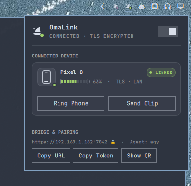
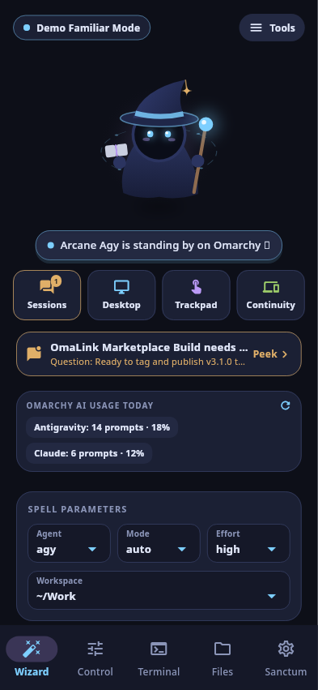
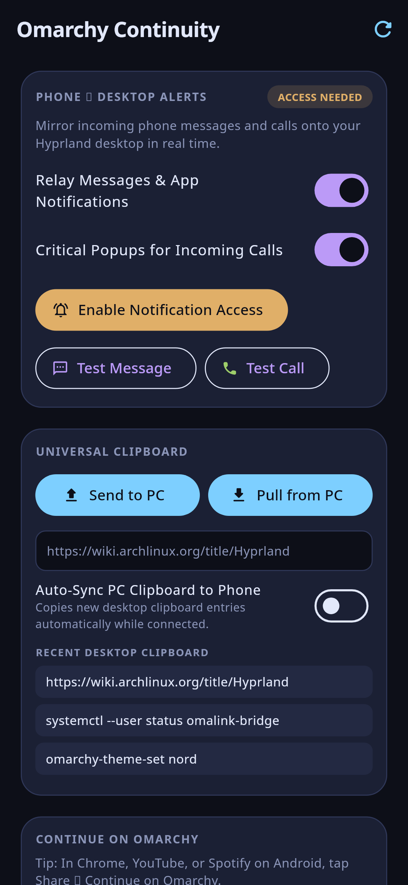
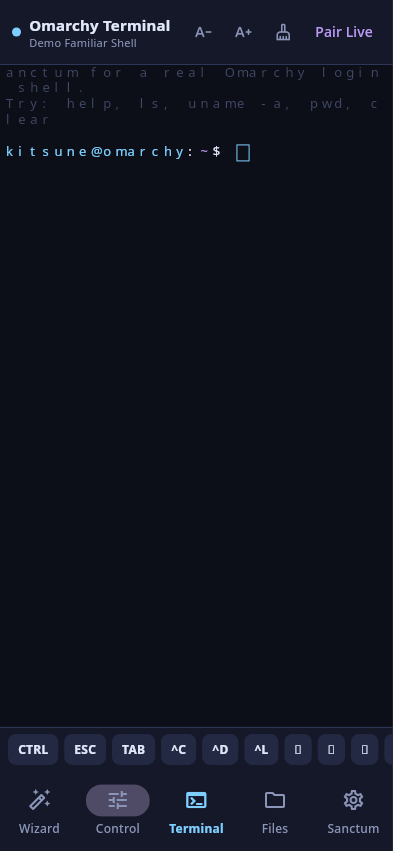
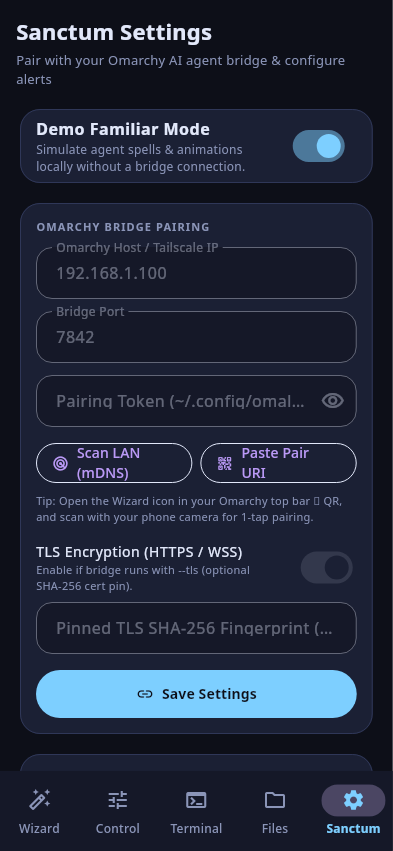

# OmaLink ✨

**Android Continuity, Remote Desktop, Trackpad, OS Control, and AI Agent companion for Omarchy Linux** — featuring a zero-dependency Python bridge, an Omarchy top-bar plugin (`omalink.panel`), live Omarchy theme syncing, silent notification-shade machine vitals + Agy limits, and 5 animated stylized mascots & switchable Android app icons.

> **Latest Android APK (`v3.7.0`):** Download `app-release.apk` and `SHA256SUMS` from [GitHub Release v3.7.0](https://github.com/M30W-M1X/omalink/releases/tag/v3.7.0) and verify with `grep '  app-release.apk$' SHA256SUMS | sha256sum -c -`.

---

## Screenshots

### Omarchy Top-Bar Plugin (`omalink.panel`) & Live AI Agent Sessions

| Omarchy Top-Bar Panel (`CONNECTED DEVICE` Card) | Live AI Agent Sessions (Peek & Reply) |
| :---: | :---: |
|  |  |

### Android Companion App

| Wizard Home & Mascot | Animated Avatars & App Icons | Companion Tools Menu | Omarchy Control Plane |
| :---: | :---: | :---: | :---: |
|  |  |  |  |

| Continuity & Notifications | Wireless Trackpad & Slides | Interactive Terminal | Sanctum & Pairing |
| :---: | :---: | :---: | :---: |
|  |  |  |  |

---

## Quick Install

### Option 1 — Omarchy Plugin Marketplace (1 Command)

```bash
omarchy plugin add https://github.com/M30W-M1X/omalink.git --enable
```

Then click the **OmaLink** icon in your Omarchy top bar and click **Install & Start OmaLink Bridge** — it automatically sets up `omalink-bridge.service` and shows your live pairing QR code right in the top bar!

### Option 2 — Let Your Omarchy AI Agent Install It

Running **Antigravity (`agy`)**, **Claude Code**, **Codex**, **OpenCode**, or **Kimi** inside Omarchy? Paste this prompt into your AI agent:

> Install **OmaLink** from `https://github.com/M30W-M1X/omalink` by following `AGENT_INSTALL.md` in that repo. Clone or update it, run `./install.sh --json`, verify `omalink-bridge.service` and `/api/ping`, validate and enable the `omalink.panel` top-bar plugin, run the bridge unit tests, check optional tools and firewall requirements (ask before running any `sudo` command), and give me the latest Android APK download link plus pairing instructions.

See [AGENT_INSTALL.md](AGENT_INSTALL.md) for the full deterministic AI agent runbook and troubleshooting guide.

### Option 3 — Digest-Verified & Commit-Pinned Release Installer

Download `install.sh` and `SHA256SUMS` for `v3.7.0`, verify the exact `install.sh` artifact against its published SHA-256 digest, inspect it, and run it pinned to the immutable 40-character commit SHA (`7cad472b1e4429bfccec77c44a96bec02c410725`):

```bash
curl -fsSLO https://github.com/M30W-M1X/omalink/releases/download/v3.7.0/install.sh && \
curl -fsSLO https://github.com/M30W-M1X/omalink/releases/download/v3.7.0/SHA256SUMS && \
echo "38016996361772f75df911fcfa23dd03c956f345d564f4ebae5b608540c70973  install.sh" | sha256sum -c - && \
grep '  install.sh$' SHA256SUMS | sha256sum -c - && \
bash install.sh --ref 7cad472b1e4429bfccec77c44a96bec02c410725
```

Before starting `omalink-bridge.service`, `install.sh` also verifies the SHA-256 digest of every runtime bridge and plugin file (`manifest.json`, `bridge/*.py`, `omarchy-plugin/*`).

Useful installer flags:
- `./install.sh --ref 7cad472b1e4429bfccec77c44a96bec02c410725` — bind remote clone to an immutable 40-char commit SHA (default: `7cad472b1e4429bfccec77c44a96bec02c410725`, release `v3.7.0`)
- `./install.sh --json` — machine-readable JSON output (used by AI agents)
- `./install.sh --check --json` — read-only health, service, plugin & tool diagnostics
- `./install.sh --tls` — enable self-signed TLS 1.2+ with SHA-256 pinning (enabled by default)
- `./install.sh --port 7842` — customize listen port (default `7842`)
- `./install.sh --show-pairing` — print the `omalink://pair` URI and terminal QR code locally
- `./install.sh --uninstall` — cleanly remove the systemd user service and top-bar plugin (add `--purge` to delete `~/.config/omalink`)

No Python pip dependencies are required — the bridge runs on **Python 3.11+ standard library only** and secures LAN traffic by default using **TLS 1.2+ with SHA-256 certificate pinning** and a **256-bit cryptographically random bearer token**.

---

## Pairing Your Android Phone

1. Download `app-release.apk` and `SHA256SUMS` from [GitHub Release v3.7.0](https://github.com/M30W-M1X/omalink/releases/tag/v3.7.0) and verify the APK digest before installing:
   ```bash
   curl -fsSLO https://github.com/M30W-M1X/omalink/releases/download/v3.7.0/app-release.apk && \
   curl -fsSLO https://github.com/M30W-M1X/omalink/releases/download/v3.7.0/SHA256SUMS && \
   echo "2703cd1e414d8d51298bd930330597599c7cb38e4e66ee69063607c12c9e8e5e  app-release.apk" | sha256sum -c - && \
   grep '  app-release.apk$' SHA256SUMS | sha256sum -c -
   ```
2. Click the **OmaLink badge** in your Omarchy top bar — it displays a live **QR code** by default (or run `./install.sh --show-pairing` in a local terminal).
3. Scan the QR code with your phone camera (opens `omalink://pair?...`) **or** open **OmaLink** -> **Sanctum** -> **Scan LAN (mDNS)** / **Paste Pair URI**.
4. If UFW is enabled on your host, allow the bridge port on your LAN:
   ```bash
   sudo ufw allow 7842/tcp
   ```

---

## Features

- **Live AI Agent Sessions (Peek, Alerts & Interactive Reply)**
  - Automatically discovers open and recent desktop **`agy`** and **`claude`** sessions, shows live tool calls and status (`NEEDS RESPONSE`, `RUNNING`, `OPEN`, `IDLE`), and fires a high-priority Android notification the moment an agent asks a question (`ask_question`) or finishes a build.
  - Peek into any session's live transcript from your phone, answer multiple-choice prompts with 1 tap, or tell the agent to keep building — either by resuming via the Agent CLI or typing straight into its open Hyprland terminal window.
- **AI Agent Remote Controller & 5 Animated Mascots / App Icons**
  - Launch, monitor, stream, cancel, and resume sessions for `agy`, `claude`, `codex`, `kimi`, and `opencode`.
  - Live AI usage & quota overview right on the home screen + high-importance Android alerts when a task finishes or fails.
  - Animated `CustomPainter` wizard mascot (**Arcane Agy**) plus 4 switchable **animated illustrated avatars** (**Anime Wizard**, **Arcane Cat**, **Cyber-Mage**, **Astral Owl**) with floating/breathing motion, rotating arcane rune rings, starlight sparkles, and mood-reactive spells — any of which can also be applied live as your **Android Home Screen App Icon**!
- **Silent Notification-Shade Vitals & Agy Limits**
  - Optional silent, ongoing Android notification card pinned to your notification shade showing live **CPU, RAM, Temp, Uptime**, and **Agy usage limits** at a glance without ever chiming or vibrating.
- **Live Omarchy Theme Sync**
  - Watches `~/.config/omarchy/current/theme/colors.toml` and dynamically re-themes every screen and the `xterm` palette on your phone whenever you switch Omarchy themes (dark or light).
- **Omarchy Control Plane & Media**
  - Live vitals (CPU, RAM, disk, temperature), PipeWire volume/mute/mic/sink switcher, MPRIS media controls (Spotify & any MPRIS player), display brightness, Hyprland workspaces & windows, Omarchy toggles (Nightlight, Stay Awake, Top Bar, Animations, Screensaver, DND, Next Wallpaper), Bluetooth devices, Omarchy reminders, screenshot preview & screen recording toggle, system updates, app launchers, power actions, and temporary Passwordless Sudo (`omarchy-sudo-passwordless`).
- **Wayland Remote Desktop & Wireless Trackpad**
  - Low-latency Wayland screen stream (`grim`), pan/zoom, virtual mouse pointer (`zwlr_virtual_pointer_manager_v1`), and keyboard input (`wtype`).
  - Dedicated **Wireless Trackpad & Presentation Remote** (1-finger move/tap, 2-finger scroll, scroll strip, L/M/R clicks, and slide navigation).
- **Continuity (Phone ↔ Omarchy)**
  - **Omarchy Top-Bar Connected Device Card:** Displays your phone's real device name (e.g. `Pixel 8`), a 10-segment visual battery gauge (showing `⚡` only when actively charging), `● LINKED` badge, 1-click **Ring Phone** & **Send Clip** (pushes desktop Wayland clipboard to your phone), and an inline notification quick-reply bubble.
  - Mirrors incoming Android notifications and calls onto your Hyprland desktop (`notify-send`) with **inline quick-reply** back to Android `RemoteInput`.
  - **Universal Clipboard** with automatic history sync and **Continue on Omarchy** Android Share Sheet target (share any link from Chrome/YouTube/Spotify to open it directly on Omarchy).
  - **Find My Phone with 1-Tap Stop Ringing:** Trigger an alarm ring from the Omarchy top bar or Control Plane and silence it immediately on your phone via the pop-up **Find My Phone Alert** dialog or the lock-screen notification's **Stop Ringing** button (just like Apple Find My iPhone).
- **Interactive PTY Terminal & 2-Way File Explorer**
  - Full login shell over WebSockets (`/ws/terminal`) with `xterm` rendering and quick-key toolbar (`CTRL`, `ESC`, `TAB`, `^C`, `^D`, `^L`, arrows).
  - Browse directories, preview files, upload/download photos & files between phone and desktop, rename, Trash (`gio trash`), open on desktop (`xdg-open`), or hand paths straight to an AI agent.
- **Android System Integrations & Security**
  - Android **Quick Settings Tile**, **Home Screen Widget**, **Demo Familiar Mode**, and optional **TLS + SHA-256 certificate pinning**.

---

## Project Structure

- `manifest.json` — Root Omarchy Plugin Marketplace manifest (`omalink.panel`, validated with `omarchy plugin validate .`).
- `install.sh` — Idempotent non-interactive installer, runtime SHA-256 digest verifier, health checker (`--check --json`), and uninstaller for Omarchy Linux.
- `AGENTS.md` — Architecture, marketplace rules, security invariants, and build/test commands for AI coding agents working on this repo.
- `AGENT_INSTALL.md` — Dedicated runbook & copy-paste prompt for AI agents installing OmaLink inside Omarchy.
- `bridge/` — Pure Python 3.11+ HTTP + WebSocket server (`omarchy_wizard_bridge.py`), OS control (`omarchy_control.py`), Continuity (`omarchy_continuity.py`), Wayland Remote Desktop (`omarchy_desktop.py`), File Explorer (`omarchy_files.py`), PTY Terminal (`omarchy_pty.py`), and unit test suite (`test_bridge.py`).
- `omarchy-plugin/` — Omarchy top-bar status badge (`omalink.panel`, `Panel.qml`, `WizardIcon.qml`, `status.py`) with live pairing QR code, 1-click bridge auto-setup, connected devices, and quick replies.
- `android_app/` — Flutter Android app (`io.github.m30w_m1x.omalink`) with Material 3 dynamic Omarchy theming, 5 animated avatars & switchable launcher icons, Quick Settings Tile, and Home Screen Widget.
- `.github/workflows/build.yml` — CI workflow running Python bridge tests, `flutter analyze`, `flutter test`, and publishing `app-release.apk` on version tags (`v*`).

---

## Uninstall / Removal

If installed via `omarchy plugin add`:

```bash
omarchy plugin remove omalink.panel
systemctl --user disable --now omalink-bridge.service
rm -f ~/.config/systemd/user/omalink-bridge.service
systemctl --user daemon-reload
```

Or using the included uninstaller:

```bash
./install.sh --uninstall        # keeps ~/.config/omalink token
./install.sh --uninstall --purge # also deletes ~/.config/omalink
```

---

## Development & Testing

### Bridge Tests (Python 3.11+)

```bash
PYTHONPATH=bridge python3 -m unittest discover -s bridge -v
```

### Flutter App Analysis, Tests & APK Build

```bash
cd android_app
flutter pub get
flutter analyze
flutter test
flutter build apk --release
```
