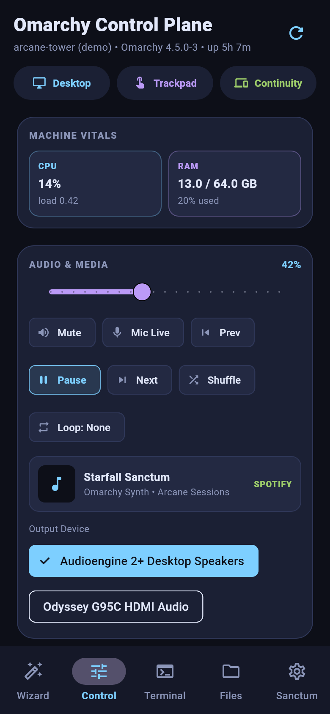

# Omarchy Wizard 🧙‍♂️✨

A **Flutter Android companion app**, zero-dependency **Python Omarchy Bridge**, and **Omarchy top-bar plugin** (`wizard.panel`) that turn your phone into a complete remote control & Continuity companion for **Omarchy Linux** — complete with AI Agent orchestration (`agy`, `claude`, `codex`, `kimi`, `opencode`), live Omarchy theme syncing, silent notification-shade machine vitals + Agy limits, Wayland Remote Desktop, Wireless Trackpad, interactive PTY Terminal, and phone-to-desktop notification mirroring.

> **Latest Android APK:** Download `app-release.apk` from [GitHub Releases](https://github.com/M30W-M1X/omarchy-wizard/releases/latest).

---

## Screenshots

| Wizard Home & Mascot | Companion Tools Menu | Omarchy Control Plane |
| :---: | :---: | :---: |
|  |  |  |

| Continuity & Notifications | Wireless Trackpad & Slides | Interactive Terminal | Sanctum & Pairing |
| :---: | :---: | :---: | :---: |
|  |  |  |  |

---

## Quick Install

### Option 1 — Let Your Omarchy AI Agent Install It (Recommended)

Running **Antigravity (`agy`)**, **Claude Code**, **Codex**, **OpenCode**, or **Kimi** inside Omarchy? Paste this prompt into your AI agent:

> Install **Omarchy Wizard** from `https://github.com/M30W-M1X/omarchy-wizard` by following `AGENT_INSTALL.md` in that repo. Clone or update it, run `./install.sh --json`, verify `omarchy-wizard-bridge.service` and `/api/ping`, validate and enable the `wizard.panel` top-bar plugin, run the bridge unit tests, check optional tools and firewall requirements (ask before running any `sudo` command), and give me the latest Android APK download link plus pairing instructions.

See [AGENT_INSTALL.md](AGENT_INSTALL.md) for the full deterministic AI agent runbook and troubleshooting guide.

### Option 2 — One-Line Shell Installer

```bash
curl -fsSL https://raw.githubusercontent.com/M30W-M1X/omarchy-wizard/master/install.sh | bash
```

Or from a local clone:

```bash
git clone https://github.com/M30W-M1X/omarchy-wizard.git ~/Projects/omarchy_wizard
cd ~/Projects/omarchy_wizard
./install.sh
```

Useful installer flags:
- `./install.sh --json` — machine-readable JSON output (used by AI agents)
- `./install.sh --check --json` — read-only health, service, plugin & tool diagnostics
- `./install.sh --tls` — enable self-signed TLS encryption (`https://` / `wss://`)
- `./install.sh --port 7842` — customize listen port (default `7842`)
- `./install.sh --show-pairing` — print the `omarchy-wizard://pair` URI and terminal QR code
- `./install.sh --uninstall` — cleanly remove the systemd user service and top-bar plugin (add `--purge` to delete `~/.config/omarchy-wizard`)

No Python pip dependencies are required — the bridge runs on **Python 3.11+ standard library only**.

---

## Pairing Your Android Phone

1. Download and install the latest `app-release.apk` from [GitHub Releases](https://github.com/M30W-M1X/omarchy-wizard/releases/latest).
2. Click the **Wizard hat badge** in your Omarchy top bar — it displays a live **QR code** by default (or run `./install.sh --show-pairing` in a local terminal).
3. Scan the QR code with your phone camera (opens `omarchy-wizard://pair?...`) **or** open **Sanctum** in the app and tap **Scan LAN (mDNS)** / **Paste Pair URI**.
4. If UFW is enabled on your host, allow the bridge port on your LAN:
   ```bash
   sudo ufw allow 7842/tcp
   ```

---

## Features

- **AI Agent Remote Controller & Mascot (`Arcane Agy`)**
  - Launch, monitor, stream, cancel, and resume sessions for `agy`, `claude`, `codex`, `kimi`, and `opencode`.
  - Live AI usage & quota overview right on the home screen + high-importance Android alerts when a task finishes or fails.
  - Animated `CustomPainter` wizard mascot that reacts to every state (`idle`, `listening`, `casting`, `awaitingApproval`, `celebrating`, `error`).
- **Silent Notification-Shade Vitals & Agy Limits**
  - Optional silent, ongoing Android notification card pinned to your notification shade showing live **CPU, RAM, Temp, Uptime**, and **Agy usage limits** at a glance without ever chiming or vibrating.
- **Live Omarchy Theme Sync**
  - Watches `~/.config/omarchy/current/theme/colors.toml` and dynamically re-themes every screen and the `xterm` palette on your phone whenever you switch Omarchy themes (dark or light).
- **Omarchy Control Plane & Media**
  - Live vitals (CPU, RAM, disk, temperature), PipeWire volume/mute/mic/sink switcher, MPRIS media controls (Spotify & any MPRIS player), display brightness, Hyprland workspaces & windows, Omarchy toggles (Nightlight, Stay Awake, Top Bar, Animations, Screensaver, DND, Next Wallpaper), Bluetooth devices, Omarchy reminders, screenshot preview & screen recording toggle, system updates, app launchers, power actions, and temporary Passwordless Sudo (`omarchy-sudo-passwordless`).
- **Wayland Remote Desktop & Wireless Trackpad**
  - Low-latency Wayland screen stream (`grim`), pan/zoom, virtual mouse pointer (`zwlr_virtual_pointer_manager_v1`), and keyboard input (`wtype`).
  - Dedicated **Wireless Trackpad & Presentation Remote** (1-finger move/tap, 2-finger scroll, scroll strip, L/M/R clicks, and slide navigation).
- **Continuity (Phone ↔ Omarchy)**
  - Mirrors incoming Android notifications and calls onto your Hyprland desktop (`notify-send`) with **inline quick-reply** back to Android `RemoteInput`.
  - **Universal Clipboard** with automatic history sync and **Continue on Omarchy** Android Share Sheet target (share any link from Chrome/YouTube/Spotify to open it directly on Omarchy).
  - **Find My Phone** ringer from desktop + phone battery readout in the Omarchy top-bar plugin.
- **Interactive PTY Terminal & 2-Way File Explorer**
  - Full login shell over WebSockets (`/ws/terminal`) with `xterm` rendering and quick-key toolbar (`CTRL`, `ESC`, `TAB`, `^C`, `^D`, `^L`, arrows).
  - Browse directories, preview files, upload/download photos & files between phone and desktop, rename, Trash (`gio trash`), open on desktop (`xdg-open`), or hand paths straight to an AI agent.
- **Android System Integrations & Security**
  - Android **Quick Settings Tile** (`WizardQuickTileService`), **Home Screen Widget** (`WizardAppWidgetProvider`), **Demo Familiar Mode**, and optional **TLS + SHA-256 certificate pinning**.

---

## Project Structure

- `install.sh` — Idempotent non-interactive installer, health checker (`--check --json`), and uninstaller for Omarchy Linux.
- `AGENT_INSTALL.md` — Dedicated runbook & copy-paste prompt for AI agents inside Omarchy.
- `bridge/` — Pure Python 3.11+ HTTP + WebSocket server (`omarchy_wizard_bridge.py`), OS control (`omarchy_control.py`), Continuity (`omarchy_continuity.py`), Wayland Remote Desktop (`omarchy_desktop.py`), File Explorer (`omarchy_files.py`), PTY Terminal (`omarchy_pty.py`), and unit test suite (`test_bridge.py`).
- `omarchy-plugin/` — Omarchy top-bar status badge (`wizard.panel`, `Panel.qml`, `WizardIcon.qml`, `status.py`) with live pairing QR code, connected devices, and service controls.
- `android_app/` — Flutter Android app with Material 3 dynamic Omarchy theming, notification services, Quick Settings Tile, and Home Screen Widget.
- `.github/workflows/build.yml` — CI workflow running Python bridge tests, `flutter analyze`, `flutter test`, and publishing `app-release.apk` on version tags (`v*`).

---

## Development & Testing

### Bridge Tests (Python 3.11+)

```bash
PYTHONPATH=bridge python3 -m unittest discover -s bridge -v
```

### Flutter App Analysis, Tests & APK Build

```bash
cd android_app
flutter pub get
flutter analyze
flutter test
flutter build apk --release
```
